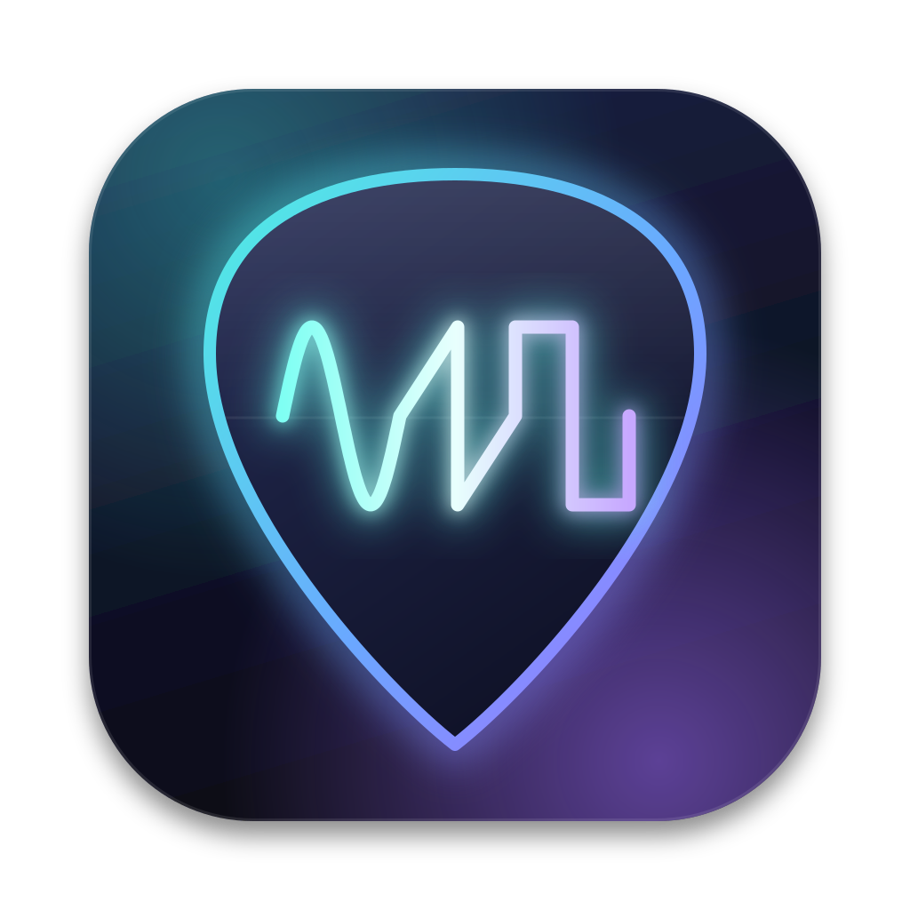

<p align="center">
  
</p>

<h1 align="center">GuitarSynthX</h1>

<p align="center">
  A native macOS guitar synthesizer. Plug in your guitar: GuitarSynthX detects
  what you play in real time and plays it back as a synth.<br>
  <a href="https://github.com/lydianb79/GuitarSynthX/releases/latest"><b>Download the latest release</b></a>
  · macOS 13+ · Apple Silicon & Intel
</p>

---

* **Plays what you play.** Low-latency pitch tracking follows your picking,
  bends, slides and hammer-ons, and turns them into synth notes.
* **Real synth, real effects.** Unison oscillators, FM, ladder and
  state-variable filters, envelopes and an LFO, followed by drive, chorus,
  phaser, delay (digital, tape and analog) and reverb (room, hall, plate,
  shimmer). 20 factory presets, plus your own.
* **Built for playing live.** A C++ engine on Core Audio with buffer sizes down
  to 16 samples, and a Metal-rendered oscilloscope, spectrum and tuner.
* **Polyphonic with a hex pickup.** A normal guitar input tracks single notes.
  A hexaphonic (GK-style, 6-channel) pickup gives one tracker and voice per
  string.

## Contents

- [Download & install](#download--install)
- [Quick start](#quick-start)
- [Using it](#using-it)
- [Getting the lowest latency](#getting-the-lowest-latency)
- [Building from source](#building-from-source)
- [Making a release](#making-a-release)
- [How it works](#how-it-works)
- [Notes and limitations](#notes-and-limitations)

## Download & install

Get the app from the [Releases page](https://github.com/lydianb79/GuitarSynthX/releases/latest)
and pick the zip for your Mac:

| Download | For |
|---|---|
| `GuitarSynthX-…-macOS-AppleSilicon.zip` | Apple Silicon Macs (M1 and later) |
| `GuitarSynthX-…-macOS-Intel.zip` | Intel Macs |

Not sure which one you have? Apple menu ▸ **About This Mac**: *Chip: Apple M…*
means Apple Silicon; *Processor: Intel…* means Intel.

1. Unzip the download and drag the app into **Applications**.
2. **First launch:** the app isn't notarized by Apple, so macOS blocks it the
   first time. Right-click (or Control-click) the app, choose **Open**, then
   **Open** again. Or try to open it, then click **Open Anyway** under
   *System Settings ▸ Privacy & Security*. You only need to do this once.
3. Click **Allow** when asked for **microphone access**. That is how the app
   hears your guitar. If you clicked *Don't Allow*, turn it on under
   *System Settings ▸ Privacy & Security ▸ Microphone*.

To check a download, compare `shasum -a 256 <file>.zip` with the checksum in
the release notes.

**You'll need:** macOS 13 Ventura or later, and an audio interface with an
instrument input. The built-in microphone works for a quick test.

## Quick start

1. Plug your guitar into your audio interface.
2. Open **Audio Settings** (⌘, or the sliders icon). Choose your interface as
   both **input** and **output** device, 48 kHz, and a 64-sample buffer.
   Click **Apply**.
3. On the **Input & Tracking** tab, set **Input Ch** to the input your guitar
   is plugged into. Play a note: the tuner display should show it. If nothing
   happens, raise **Input Gain** or lower **Gate**.
4. Pick a sound from the **Presets** list on the left and play.

Play single notes with a normal guitar input. Chords need a hex pickup (see
[Notes and limitations](#notes-and-limitations)).

## Using it

| Area | What it does |
|---|---|
| **Presets** (left) | 20 factory sounds in five groups: **Lead** (Fat Saw Lead, Square Lead, Screaming Lead, Glide Saw, Ambient Lead, Bend Sine, Chiptune), **Bass** (Synth, Acid, Sub), **Pad** (Warm Pad, Shimmer Pad, String Ensemble, Hollow Pulse Pad), **Keys** (FM Bell, Electric Piano, Organ) and **FX** (Talking Wah, Noise Sweep, Space Echo Pluck). **Save** stores your own in `~/Library/Application Support/GuitarSynthX/Presets`. Loading a preset changes only the sound; your input, gate and tracking settings stay as they are. |
| **Input & Tracking** | Mono/Hex input mode, input channel, gain, gate, output channel pair. Pitch range, sensitivity, stability and analysis rate. **Pitch Mode**: *Track* follows bends and vibrato exactly; *Quantize* snaps to semitones; *Quantize+Glide* adds portamento. **Pick Retrigger** restarts the envelopes on every pick; turn it off to play everything legato. **Dynamics** makes the synth volume follow your playing. |
| **Oscillators** | Osc A (up to 7-voice unison), Osc B (semitones/fine tune), FM from B to A, pulse width, sub-oscillator, noise. |
| **Filter** | 24 dB ladder or 12 dB low-pass/band-pass/high-pass, drive, key tracking, **Pick Dynamics** (picking harder opens the filter, like an auto-wah), filter envelope. |
| **Amp & LFO** | Amp envelope and velocity. LFO with fade-in for vibrato, filter, pulse width and tremolo. |
| **Effects** | Drive → Chorus → Phaser → Delay → Reverb, then the limiter. |
| **Delay** | *Digital*, *Tape* (wow, flutter, warm saturated repeats) or *Analog* (dark repeats like a vintage pedal). Free time or **tempo sync** (1/2, 1/4, 1/4 T, 1/8 dotted, 1/8, 1/8 T, 1/16 at any BPM). Feedback, mix, low cut, high cut, modulation, ping-pong, and **ducking** (echoes drop back while you play and swell in when you stop). |
| **Reverb** | *Room*, *Hall* or *Plate*. Size, decay up to 20 s, pre-delay, low cut, high cut, modulation, width, ducking, and **Shimmer** (an octave-up shine that climbs with every repeat). |
| **Master** (right) | Synth level, **Dry Guitar** blend, master volume, limiter, **Dry > FX** (whether your clean guitar also goes through the effects), input and output meters. |

**Knobs:** drag up or down, hold ⇧ for fine control, double-click to reset.
**Shortcuts:** ⌘R starts/stops audio, ⌘. silences everything (panic),
⌘, opens Audio Settings.

The top bar shows the hardware round-trip latency, the DSP load (the share of
the real-time budget the audio engine uses), dropouts (*XRUNS*) and active
voices.

## Getting the lowest latency

1. **Use one device for input and output.** The app then runs input and output
   in a single callback with no extra buffering. Two separate devices work too,
   bridged by a small safety buffer; if you must use two, combine them into an
   *Aggregate Device* in Audio MIDI Setup.
2. **Buffer size 32–64 samples.** If the *XRUNS* counter keeps climbing, go up
   one step.
3. **48 kHz** is the sweet spot. Higher rates shorten buffers but cost more CPU.
4. **Set Gate** just above your guitar's noise floor, and set **Lowest Note**
   to the lowest note you actually play. A higher lowest note means faster
   detection and less CPU.

### How fast is detection?

A pitch can't be known until about one to two cycles of the string's vibration
have arrived. GuitarSynthX starts analysing right after the pick attack, using
only post-attack audio, with a window that grows as audio comes in. High notes
lock in within a few milliseconds; the low E string (82 Hz) takes about
20–25 ms. On the synthetic test set at 48 kHz, 45 of 45 notes were detected
correctly, on average about 12 ms after the pick. Your audio interface's own
latency comes on top of that.

## Building from source

**Requirements:** macOS 13+, and Xcode 15+ or just the Xcode Command Line
Tools (Swift 5.9 or later).

```bash
git clone https://github.com/lydianb79/GuitarSynthX.git
cd GuitarSynthX
./Packaging/build_app.sh
open build/GuitarSynthX-AppleSilicon.app      # or GuitarSynthX-Intel.app
```

`build_app.sh` compiles each architecture separately, packages the apps,
adds the icon and signs them ad-hoc. It produces three apps in `build/`:

| App | Runs on |
|---|---|
| `GuitarSynthX-AppleSilicon.app` | Apple Silicon (arm64) |
| `GuitarSynthX-Intel.app` | Intel (x86_64) |
| `GuitarSynthX-Universal.app` | Both (about twice the size) |

| Command | Builds |
|---|---|
| `./Packaging/build_app.sh` | All three apps (default) |
| `./Packaging/build_app.sh native` | Only the app for this Mac (fastest while developing) |
| `./Packaging/build_app.sh arm64` | Only the Apple Silicon app |
| `./Packaging/build_app.sh x86_64` | Only the Intel app |

Other ways to run it:

```bash
swift run -c release GuitarSynthX    # straight from the package (generic icon)
open Package.swift                   # in Xcode: GuitarSynthX scheme, Release, ⌘R
```

### Tests

```bash
./Tests/run_tests.sh
```

The engine tests need no audio hardware, so they also run on Linux. They play
synthetic plucked strings (E2–C6 at 44.1, 48 and 96 kHz) into the pitch
tracker, and check:

* note accuracy and detection time
* legato slides, and re-picks over a still-ringing note
* that long notes don't retrigger by themselves
* delay timing with tempo sync, and ducking
* reverb tails decaying at every type and shimmer setting
* NaN/overflow safety at extreme settings
* CPU load in mono and hex mode

## Making a release

1. Bump `CFBundleShortVersionString` (and `CFBundleVersion`) in
   `Packaging/Info.plist`, commit and push.
2. Build the apps: `./Packaging/build_app.sh`
3. Zip the apps for each architecture. `ditto` keeps the code signature intact:
   ```bash
   VERSION=1.1.0
   mkdir -p dist
   for n in AppleSilicon Intel; do
     ditto -c -k --keepParent "build/GuitarSynthX-$n.app" "dist/GuitarSynthX-v$VERSION-macOS-$n.zip"
   done
   shasum -a 256 dist/*.zip
   ```
4. Publish on GitHub, putting the checksums into the release notes:
   ```bash
   gh release create "v$VERSION" dist/GuitarSynthX-v$VERSION-macOS-*.zip \
     --title "GuitarSynthX v$VERSION" --notes-file dist/RELEASE_NOTES.md
   ```
   Or create it in the browser under **Releases ▸ Draft a new release** and drag
   in the zips.

`dist/` and `build/` are ignored by git.

## How it works

```
Sources/
  GSXCore/                 C++17 real-time engine (C API in include/GSXCore.h)
    AudioIO.cpp            Core Audio HAL: one duplex AUHAL, or two devices + lock-free ring
    Engine.cpp             signal flow: input → trackers → voices → effects → limiter
    PitchTracker.cpp       band-limit and decimate to ~24 kHz, onset detection
                           (level jump + pick noise), YIN via vDSP_conv,
                           growing post-onset window, octave-error guards
    Synth.cpp              PolyBLEP oscillators, ZDF ladder + TPT SVF filters, ADSR
    Effects.cpp            drive, chorus, phaser, delay, FDN reverb with shimmer, limiter
    Params.cpp             parameter table (the UI is generated from it)
  GuitarSynthX/            SwiftUI app
    MetalVisualizer.swift  MTKView renderer + Metal shaders
    SynthController.swift  devices, engine lifecycle, presets, saved settings
Packaging/
  build_app.sh             builds the per-architecture apps
  Info.plist, *.entitlements
  Icon/                    AppIcon.svg (source), AppIcon-1024.png, AppIcon.icns
Tests/                     engine tests and benchmark
```

Rules on the audio thread: no memory allocation, no locks, no Swift or
Objective-C runtime calls. Parameters cross threads as atomics, and the engine
recomputes coefficients only when something changed. Denormals are flushed to
zero. A NaN/Inf guard mutes and resets the engine instead of sending garbage to
your speakers.

## Notes and limitations

* **Single notes on a normal guitar input.** Chords need a hexaphonic pickup
  and **Hex** input mode on the *Input & Tracking* tab.
* **Not notarized.** Releases are signed ad-hoc, so macOS shows a warning on
  first launch (see [Download & install](#download--install)). Removing it
  requires signing with an Apple Developer ID and notarizing.
* **Unplugging the audio device** while the app runs stops the audio. Choose a
  device again in Audio Settings.
* **Intel build:** compiled and checked, but not yet tested on an Intel Mac.
  Feedback is welcome.
